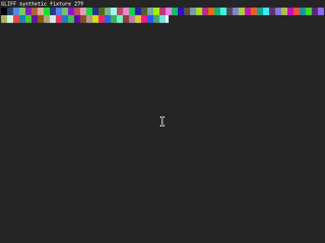
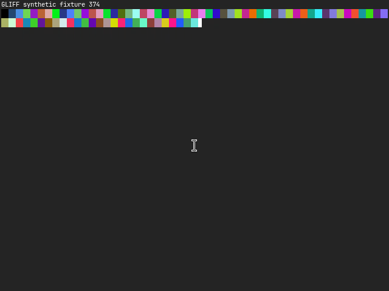

# Live server validation — 2026-10-28

All three captures were recorded over SSH from the unmodified upstream server at
`58c742452ded3f10a2ce61f60eb4845f18205e29` on `omarchy-mbp`. The release build used
Rust 1.90.0 and `cargo build --release --locked -p gliff-server`. Existing system
libraries and a temporary Rust installation sufficed; no system packages were installed.

Hyprland 0.56.2 used its Lua configuration. A dedicated `task02-fixture` headless
output displayed fullscreen `foot -c /dev/null` running generated ANSI colour cells
and a counter. No physical desktop was captured. The manifests contain precise
commands, host, encoder, driver, capture format, frame metadata and decoded hashes.

| Stream | Actual pipeline | Frames | Configuration |
| --- | --- | --- | --- |
| live-cpu-single420 | OpenH264 CPU | 45 | 640×480 → 800×600, decoder generation 1 → 2 |
| live-cpu-dual420 | OpenH264 CPU, `--full-chroma` | 20 main/aux pairs | 640×480, pacing update |
| live-gpu-dual420 | Intel UHD 630 Vulkan + VA-API | 20 main/aux pairs | 640×480, pacing update |

The GPU logs explicitly identify the Intel iHD 26.3.5 driver and Mesa 26.2.5,
`/dev/dri/renderD129`, and `using the GPU video pipeline`; the on-wire configuration
also identifies `gpu`. This capture did not fall back to CPU. Capture buffers were
linear XR24 dmabufs. All streams decode with the upstream OpenH264 reference decoder.

## Repeating a recording

Build the pinned server on a Linux host with Hyprland active. Set
`XDG_RUNTIME_DIR` and `HYPRLAND_INSTANCE_SIGNATURE` for that session. On this Lua
configuration the temporary output and mode were created using:

```bash
hyprctl output create headless task02-fixture
hyprctl eval 'hl.monitor({output="task02-fixture",mode="640x480@60",position="auto",scale=1})'
```

Launch a synthetic pattern fullscreen on that output before recording. On this host:

```bash
hyprctl eval 'hl.exec_cmd("[monitor task02-fixture; workspace 6 silent] foot -c /dev/null -F -a gliff-fixture python3 /tmp/gliff-task02-pattern.py")'
```

The pattern program clears the terminal and prints a counter plus 80 true-colour
background cells every 100 ms; cell RGB values are `(i*37, i*71, i*113) % 256`.
Workspace 6 was a fresh workspace assigned to the temporary output on this run;
choose a fresh workspace on another session. Verify its client/output before capture.
Use each manifest's `command`, substituting the SSH host and server binary path.
For Single420, after two seconds change the monitor mode to `800x600@60` with the
same `hl.monitor` call. This tests capture/encoder rebuild after an external mode
change; it does not test client-requested `Resize` on a server-owned headless output.

After recording, stop the pattern process and remove only the temporary output:

```bash
hyprctl output remove task02-fixture
```

## Offline checks and evidence

`scripts/check.sh` includes parsing each recorded message against its manifest,
fragmented reads at eight chunk sizes, full reference decoding/hash comparison,
and byte-for-byte replay through `serve` → `record`. These need no Linux host.
Live output is intentionally not regenerated by CI.





Remaining hardware coverage: GPU Single420, other GPU vendors, and a live
client-requested headless resize. The committed synthetic streams retain explicit
headless resize and keyframe recovery coverage. Intel macOS remains compile-only.
