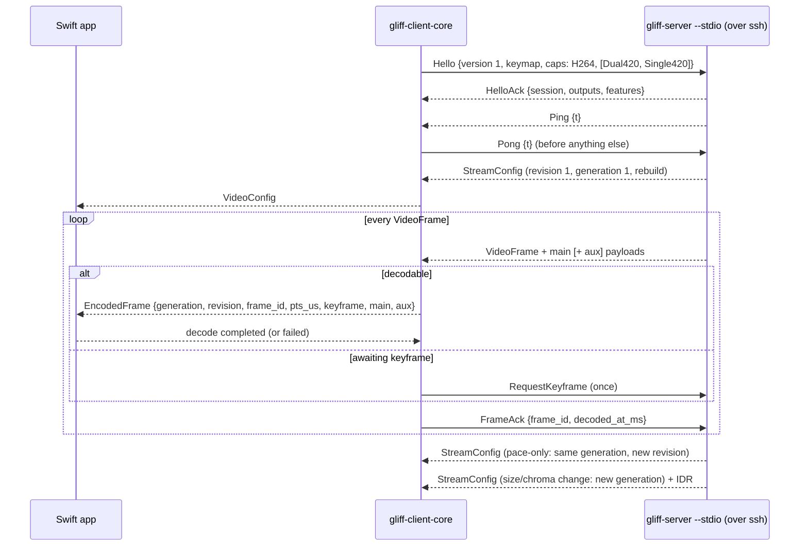

# Session and video contract

Status: provisional, executable. The Rust side is implemented in
`crates/gliff-client-core` (`events`, `video`, `annexb`) and enforced by
`tests/replay.rs` and `tests/mock_peer.rs`. Task 04 exposes these records through the
UniFFI facade; task 05 adds the session task, queues and timing around them. Field names
below are the Rust names; the Swift names follow UniFFI's conversion.

## Records

`DecoderSupport { codecs, chroma }` — exactly what the native decoder implements;
`ClientCaps.codecs`/`chroma` are built from it. Initially `[H264]`, `[Single420]` (task 07);
`[Dual420, Single420]` once task 08 lands. Native444, H.265, AV1, RawBgra: never.

`VideoConfig` — one per `StreamConfig`:

| Field | Meaning |
| --- | --- |
| `generation` | Decoder generation: 1, then +1 when coded size or chroma changes |
| `revision` | 1, then +1 per `StreamConfig` (pace-only included) |
| `rebuild` | This configuration needs a new decoder session |
| `codec`, `chroma`, `pipeline` | `H264`; `Single420`/`Dual420`; server `cpu`/`gpu` for stats |
| `width`, `height` | Coded size, physical pixels; even, ≤ 4096 |
| `view_width`, `view_height` | Fit box before window fitting; ≥ half the stream |
| `scale_milli` | Stream pixels per logical pixel ×1000; logical size = size / scale |
| `fps_cap` | Ceiling in force, for stats and presentation pacing |

`EncodedFrame` — one access unit (Single420) or main/aux pair (Dual420):
`generation`, `revision`, `frame_id`, `pts_us`, `keyframe`, `damage`, `main` (Annex B),
`aux` (Annex B, present iff Dual420). A keyframe's main and aux each start with SPS and PPS
before the IDR slices.

`FrameDisposition` — `Decode(EncodedFrame)` or `AwaitKeyframe { frame_id,
request_keyframe }`.

`ServerEvent` — `HelloAck`, `Ping` (answer `Pong` first), `Pong`, `Config`, `Frame`,
`CursorShape { …, argb: Option }` (`None`: malformed, ignored), `CursorPos`, `Clipboard
{ msg, data }` (to `gliff_transport::clipboard::Transfers`), `Error { code, message }`
(retryable server error, the session then ends).

`SessionError` — `Transport` (I/O, limits, decode, `Closed`), `Contract`
(`ContractError`), `VersionMismatch { client, server, reason }`, `Incompatible { code,
message }`, `UnexpectedFirstMessage`, `RepeatedHelloAck`. `is_fatal_incompatibility()`
is true for version, incompatible-code and contract errors: the app shows the reason and
does not auto-reconnect.

## Rules

1. **Handshake.** First server message must be `HelloAck` with `PROTOCOL_VERSION`, or
   `Error`. `Pong` is written before any other client message after a `Ping`.
2. **Configuration.** A config outside `DecoderSupport`, with invalid size/view, is a
   contract error. On `rebuild`, every queued frame of the old generation is discarded
   (not decoded, still acked) and the native decoder session is replaced. A pace-only
   config changes timing/geometry metadata for following frames only.
3. **Association.** Payloads are read in wire order: main `data_len` bytes, then aux
   `aux_len` bytes. `aux_len > 0` iff Dual420, else contract error. Main and aux of one
   frame travel together across the FFI; they are never queued separately.
4. **Ordering.** `frame_id` strictly increases. Frames are decoded in arrival order.
5. **Keyframes.** After a rebuild, or after `lose_reference()` (native decode failure,
   abandoned compressed data), predicted frames are dropped until a keyframe; one
   `RequestKeyframe` is sent per loss. A keyframe without in-band SPS/PPS is a contract
   error (VideoToolbox needs them for its format description).
6. **Acknowledgement.** Every accepted frame gets exactly one `FrameAck`, in order:
   decoded frames when the native decoder reports completion (success or failure),
   dropped frames immediately. `decoded_at_ms` is the client's wall clock. The server's
   rate control counts unacknowledged bytes, so a missing ack stalls the stream and a
   late ack lowers the bitrate.
7. **Completion semantics (task 07).** VideoToolbox decodes asynchronously; completion is
   the output callback for that frame (`kVTDecodeInfo_*` flags), not submission. For
   Dual420, completion is when both main and aux callbacks have fired. Rust sends the ack
   when Swift reports completion through the bridge; Swift never writes to the wire.
8. **Queues (task 05).** Compressed frames are bounded by count and bytes (initial
   budget: 4 frames and 2 × the largest keyframe seen, never below 8 MiB). When the budget
   would be exceeded, the client stops reading (back-pressure on the ssh pipe) rather
   than dropping compressed frames; if data must be abandoned, it acks the dropped frames,
   calls `lose_reference()` and requests a keyframe. Decoded pictures are latest-wins
   (upstream `undelivered`): a newer picture replaces an undisplayed one.
9. **Presentation timing.** `pts_us` is the server capture wall clock, useful for
   latency statistics only (clock offset unknown). Presentation follows decode
   completion and the display link, capped by `fps_cap`; no jitter buffer is added.
10. **Disconnect.** `Closed` anywhere (including mid-frame truncation, which upstream
    reports the same way) ends the session; no partial frame reaches the decoder. Queued
    frames are discarded, the decoder session is invalidated, the ssh child is killed.
    `Error` 1–255 and contract errors are not retried; `ERROR_SETUP` and transport errors
    may be retried by task 10's reconnection policy.

Rules 1–6 and 10 are executable today. Rules 7–9 are the specification tasks 05 and 07
implement; their budgets are initial values to be measured in task 12.

## Pacing measured on fixtures

`tests/mock_peer.rs` runs the full exchange through a 512-byte in-memory pipe: the
server streams while the client answers `Pong` first and acks each frame. The mock server
observes `Pong`, then one ack per frame in `frame_id` order, then `Bye`. With the IDR
removed, it observes acks for every dropped frame, exactly one `RequestKeyframe`, and
decoding resumes at the forced IDR. Live pacing (RTT, bitrate ladder response, ack timing
against VideoToolbox) needs a real server and is task 12's measurement.
