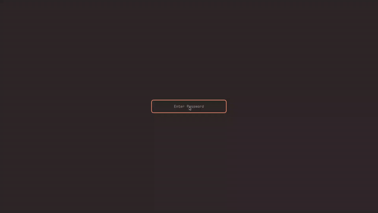
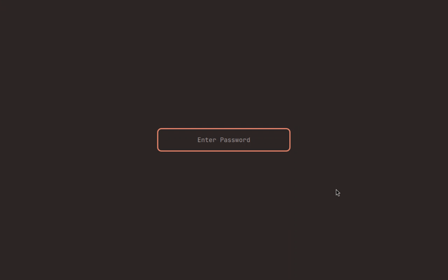

# Task 03 implementation record

Updated: 2026-10-29. Branch `feat/automate-upstream-sync`. Status: in review.
Upstream `main` is still `58c742452ded` (v0.4.1, the pin), so no real upgrade exists;
the workflow was rehearsed with the baseline, a stale pin and a simulated incompatible
upstream commit, and none of these is reported as an upgrade.

## Delivered

- `scripts/upstream.py`: `status` (pin vs upstream `main`, or a given SHA), `update`
  (explicit full SHA only; clean parent and vendor; trusted commit on upstream `main`
  or a release tag; refuses stale/diverged candidates without `--allow-stale`; stages
  gitlink, `upstream-revision`, lockfile synchronisation and an unqualified candidate
  record together; writes a focused report), `abort`, `report OLD NEW`, `check`,
  `record`, `qualify` and `cache-key`.
- `scripts/gates.py` behind `scripts/check.sh`: 15 required gates and 8 planned gates
  (tasks 04–12) with `passed`/`failed`/`unavailable` and a JSON summary per platform.
- Protocol-surface gate: `crates/gliff-client-core/tests/protocol_surface.rs` and
  `tests/compatibility/protocol-surface.json` (version, features, error codes, frame
  limits and exact CBOR of every client and server message).
- `scripts/live-host-check.sh`: builds the unmodified server at an exact SHA on a
  Linux/Hyprland host with upstream's lockfile, records a real headless session with
  a client `Resize`, and replays it through the client contract and reference decoder.
- `tests/compatibility/`: `matrix.json` (initial release, current pin, candidate),
  report template and README.
- CI: `ci.yml` is reusable, uploads gate summaries, caches by upstream SHA, both app
  lockfiles, Rust, UniFFI, Xcode and target, and runs the upstream workspace in its
  own Arch environment and lockfile (`upstream-linux`). `upstream.yml` runs daily and
  on demand with an exact SHA, keeps one `task/upstream-candidate` branch/PR, runs the
  app checks on it and posts the report and gate table; it never merges. Pull requests
  touching the automation rehearse it without pushing.
- Workspace profiles keep release build scripts and proc macros unstripped: Xcode 27's
  `strip` removed their rustc metadata, so release builds (and the portability audit)
  failed on this Mac with "can't find crate for `tokio_macros`", also on `main`.

## Evidence

Local Mac: macOS 27.0.1 arm64, Xcode 27.1, Rust 1.90.0. `scripts/check.sh`: 13 passed,
0 failed, 10 unavailable (`upstream-linux` runs in CI, `live-host` needs evidence,
8 planned). CI adds Linux and macOS-15/Xcode 16.4 summaries.

Live host `omarchy-mbp` (Omarchy, Linux 7.2.11 x86_64, Hyprland 0.56.2, Intel UHD 630):
unmodified `gliff-server 0.4.1` at the pin, upstream lockfile `0dfd5f89…`, `--headless`.

| Run | Pipeline | Configurations | Frames decoded | Evidence |
| --- | --- | --- | --- | --- |
| CPU Single420 | OpenH264 | 1920×1080 → 1280×800 after client `Resize` | 4/4 | [json](evidence/live-cpu-single420.json) |
| GPU Dual420 | Vulkan + VA-API | 1920×1080 → 1280×800 after client `Resize` | 4/4 pairs | [json](evidence/live-gpu-dual420.json) |

This also covers the client-requested headless resize that task 02 left open. The
headless output shows Hyprland's default background only:

Update/rollback rehearsal in a disposable clone ([script](evidence/rehearsal.sh),
[log](evidence/update-rollback-rehearsal.log)):

1. Baseline candidate equal to the pin: report written, nothing staged, "not an upgrade".
2. Abbreviated SHA and branch name refused.
3. v0.4.0 refused as stale; with `--allow-stale` its record says `stale`/`unqualified`,
   then `abort` restores a clean tree.
4. A local commit on top of the pin standing in for upstream `main` (protocol version 2,
   `FrameAck.decoded_at_ms` renumbered): a clean `bootstrap.sh` stays on the pin;
   `status` reports one new commit.
5. `update` stages it; the report flags the version and field-numbering change. The
   gates fail: `protocol-surface` lists the five changed surface entries with guidance,
   and the mock-peer tests report "Server version is too old". `qualify`: failed.
6. `git revert` of the update commit plus `git submodule update` restores the pin and
   passing gates.

## Limits and follow-ups

- The scheduled/manual workflow can only run from the default branch; on this pull
  request it runs in rehearsal mode. Creating its pull request with `GITHUB_TOKEN`
  needs the repository setting *Allow GitHub Actions to create and approve pull
  requests*, which is currently off.
- Planned gates stay unavailable and not required until tasks 04–12 implement them.
- Intel macOS remains compile-only; other GPU vendors are not covered by the live host.
