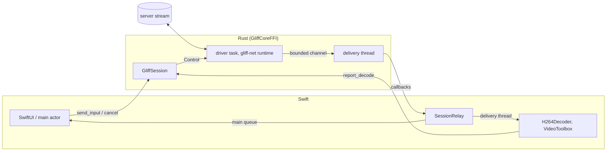

# Rust/Swift bridge contract

Status: implemented for recorded streams and SSH. Code: `crates/gliff-client-core/src/session.rs` (transport-independent driver),
`crates/gliff-mac-core` (UniFFI facade), `macos/Packages/GliffCore` (Swift package and
`SessionRelay`). It implements the [session and video contract](../02-audit-upstream-protocol-and-portability/session-video-contract.md)
across the FFI.

## Layers

- `gliff-client-core::session` owns the wire: `Hello`, `Pong` first, ordered `FrameAck`s,
  `RequestKeyframe`, input and `Bye`. It is generic over `AsyncRead`/`AsyncWrite` and has no
  FFI types; the mock-server tests drive it directly.
- `gliff-mac-core` converts records to FFI types (`Vec<u8>` → Swift `Data`, one copy)
  and owns threads and the delegate. Swift sees only these app-owned types, never
  `gliff-proto` enums.
- Swift never writes to the wire: it reports decode outcomes and sends input commands.

## API

| Item | Role |
| --- | --- |
| `GliffSession(target:options:)` | Validates and builds; nothing runs. Typed `GliffError.InvalidOptions` |
| `ConnectionTarget.ssh(host:user:port:serverPath:identityFile:headless:videoMode:)` | `VideoMode` is a closed enum: `.auto` adds no flag, `.cpu`/`.gpu` add `--video cpu`/`--video gpu` (the pinned server rejects `--video auto`). Restricted host/user syntax, nonzero port, literal remote executable (no leading `~`) and optional absolute identity path; starts system OpenSSH with strict verification and batch authentication |
| `ConnectionTarget.replay(stream:)` | A recorded `.gliffstream`, for tests and diagnostics; client messages are counted, not sent |
| `SessionOptions` | Decoder chroma modes advertised to the server, preferred first (SSH and replay alike since task 08; the app sends `[Dual420, Single420]`), keymap, in-flight budget (default 4 frames, 8 MiB) |
| `start(delegate:)` | Once; `AlreadyStarted` afterwards. A refused start keeps no delegate |
| `reportDecode(frameId:outcome:)` | `decoded`, `failed` (requests a keyframe) or `discarded`; `UnknownFrame`, `NotRunning` |
| `sendInput(event:)` | Key (evdev), pointer, scroll, resize, keymap change (XKB text, sent in queue order before later keys); `Busy` beyond 256 queued, `NotRunning` after the end |
| `cancel()` | Idempotent, non-blocking; dropping the last reference cancels too |
| `state()` | Connecting before start, handshaking until first stream configuration, streaming, stopping, closed or failed |
| `stats()` | Counters: configs, frames delivered/dropped/failed, acks, keyframe requests, pongs, inputs, in-flight peaks |
| `SessionDelegate` | `onConnected`, `onVideoConfig`, `onFrame`, `onCursorShape`, `onCursorPosition`, `onServerError`, `onEnded` |
| `SessionEnd` | `closed`, `cancelled` or `failed(GliffError)`; `isFatalIncompatibility` says whether reconnecting can help. Since task 10, `Transport` is a link failure an app may retry automatically, and `Setup` (host key, key authentication, missing server) needs the user's action first |

Clipboard messages are read and ignored, and no clipboard feature is advertised; task 11
adds clipboard callbacks and commands on this delegate/session pair. No wire API is
duplicated ahead of that need.

## Threads and ownership

| Thread | Runs | Never |
| --- | --- | --- |
| `gliff-net` (shared Tokio runtime, 2 workers) | Driver: read, write, acks, back-pressure | Calls Swift |
| `gliff-delivery` (one per started session) | Every delegate callback, one at a time, in wire order | Reads or writes the network |
| Main thread | `SessionRelay` events for SwiftUI state | Receives frames |
| Any Swift thread | `reportDecode`, `sendInput`, `cancel`, `stats` (lock-protected, return at once) | Blocks on the network |

The session holds the delegate strongly from `start` until `onEnded` returns, then
releases it. `GliffSession` does not reference the delegate's owner; `SessionRelay`
captures nothing but its two closures, so interface models are captured weakly there.

## Ordering, generations and acknowledgement

1. Deliveries follow wire order: `onConnected`, then each `onVideoConfig` before the
   frames of its revision.
2. When a configuration rebuilds (new `generation`), frames of older generations still
   queued for delivery are reported `discarded` by the bridge and never reach Swift.
   Swift replaces its decoder on `rebuild`; frames already handed to it are still
   reported (decoded, failed or discarded).
3. Every frame the tracker accepted is acknowledged exactly once, in `frame_id` order:
   a frame reported early waits for earlier ones. Frames dropped while waiting for a
   keyframe are acked without delivery.
4. A `failed` or `discarded` report for the current generation loses the reference
   (unless the frame is older than the last keyframe delivered, or a loss is already
   being recovered): one `RequestKeyframe` is sent, the driver drops predicted frames
   it reads until a keyframe, and the bridge discards (and acks) predicted frames
   already queued for delivery, so the next frame the decoder sees is a keyframe.

## Budgets and back-pressure

- In flight means delivered and not yet reported. The driver stops reading when
  `max_in_flight_frames` (default 4) are in flight or their bytes reach the budget
  (`max(min_in_flight_bytes, 2 × largest keyframe)`, default floor 8 MiB). At most one
  frame beyond the byte budget is read before it stops. The ssh pipe then fills and the
  server paces itself; compressed frames are never dropped to make room.
- Other deliveries use a 32-entry channel: a slow callback stalls the driver, not memory.
- `SessionRelay` posts to the main queue in FIFO order; consecutive cursor positions are
  coalesced (latest wins) and never cross another event; the other events are rare by
  protocol.
- Input waits in a 256-entry queue; beyond it `sendInput` fails with `Busy`.

## Cancellation and teardown

- `cancel()` (or dropping the session) sets a flag the driver races in every wait,
  including writes blocked on a peer that stopped reading. The driver sends `Bye`
  (bounded to one second) unless a write was interrupted mid-frame, marks the session
  finished, and returns.
- After cancellation the delivery thread drops queued deliveries, delivers
  `onEnded(.cancelled)` and exits. At most the callback already running completes first.
- `onEnded` is the last callback, exactly once, including when the stream closes or a
  contract error ends the session. If the driver task panicked, the delivery thread
  still ends with `failed(Protocol)`.
- After the end, `reportDecode` and `sendInput` return `NotRunning`. A session is not
  restarted: create a new one to reconnect (task 10).
- A recorded stream drains: at its end the driver waits for in-flight reports and acks
  them before `closed`. A live server is gone at that point, so task 05 does not drain.

## Not covered yet

- Live and Finder-environment transport acceptance passed in task 05; native VideoToolbox decode with completion-driven reports passed in task 07; real multi-hop routes are tracked in task 12.
- Zero-copy frames (`Data` without a copy) and a measured budget: task 12. Task 07
  copies each frame once more, into its CoreMedia sample, while rewriting start codes
  to length prefixes.
- x86_64 runtime: both slices are built and linked here; running them needs Intel
  hardware (this Mac has no Rosetta), a hardware gate of task 12.

`state()` exposes connecting (constructed), handshaking (started), streaming (first StreamConfig accepted), stopping, closed and failed. Poll this query for UI state; callback ordering is unchanged. SSH and replay advertise H264 with the configured chroma modes (task 05–07 forced Single420 on SSH until task 08 implemented Dual420). Startup is bounded to 20 seconds including blocked Hello writes; OpenSSH connection attempts use 10 seconds. A native frame awaiting completion for 15 seconds ends with a transport timeout, including while a write or delivery is blocked. Teardown kills/reaps SSH and drains or aborts/joins the bounded stderr worker before onEnded. Diagnostics use fixed setup guidance rather than returning raw stderr.

User names accept only ASCII letters, digits, `.`, `_` and `-`, with no leading
`-`. Server executables are quoted literally: use an absolute path, a relative
path, or an executable name on the remote PATH; `~/...` is rejected with guidance.
User RemoteCommand and tunnel settings are disabled so the session can own its
server command and transport. Timeout diagnostics retain their original phase
even when SSH emits warnings; an established session's unexpected exit is
reported as a session failure rather than a startup failure.
