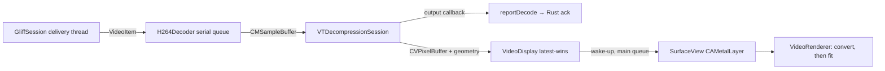

# Task 07 implementation record

Updated: 2026-10-30. Branch `feat/decode-and-display-h264`. Status: in review.
Dependencies 05 and 06 are merged. Upstream remains the unmodified pinned
`58c742452ded3f10a2ce61f60eb4845f18205e29` (`gliff-server 0.4.1`). No Rust
or bridge change was needed: the task-04 contract already carried what the
decoder needs.

## Delivered behavior

Live sessions now decode Single420 H.264 with VideoToolbox and show it in the
remote surface through Metal. Task 06's placeholder, which reported frames
`decoded` without decoding them, is gone.

| Piece (`macos/GliffMac/Video`) | Role |
| --- | --- |
| `AnnexB.swift` | Splits Annex B at 3/4-byte start codes like `gliff-client-core::annexb`; separates SPS/PPS, drops access unit delimiters, rewrites the rest with 4-byte lengths; rejects leading bytes, empty units, the forbidden bit and units without a slice |
| `H264Decoder.swift` | Serial-queue owner of the `VTDecompressionSession`, format and configuration; asynchronous decode; one report per frame from its output callback |
| `VideoDisplay.swift` | Latest-wins hand-off to the surface (at most one waiting picture), the still image, diagnostics counters |
| `DecodedFrame.swift` | Decoded picture with its geometry, colour conversion, generation and frame ID; `FrameGeometry.fit`; `ColorConversion` |
| `VideoRenderer.swift` | Metal: exact YCbCr → RGB conversion pass, then the fitted presentation pass |

`LiveSession` gives the relay's video side to the decoder and exposes its
`VideoDisplay`; `SessionController` publishes the current session's display
(and `StreamInfo.displaysVideo`); `RemoteSurface.SurfaceView` hosts a
`CAMetalLayer` and draws from the display.

### Decode and feedback

- The bridge's delivery thread only enqueues on the decoder's queue, so it
  never waits for VideoToolbox. Frames are bounded upstream by the bridge's
  in-flight budget (4 frames, 8 MiB floor), so this queue is too.
- Each frame is submitted with `kVTDecodeFrame_EnableAsynchronousDecompression`
  and its own output handler. The handler reports `decoded` or `failed` to Rust
  directly from VideoToolbox's thread, before presentation, so acknowledgements
  never wait on the main thread, the window or drawing. A frame VideoToolbox
  rejects synchronously is reported once, guarded against its callback.
- Frames that are not decoded are reported `discarded`: older generation, before
  the first keyframe, after a failure until a keyframe, or after teardown.
- `kVTDecompressionPropertyKey_RealTime` is set; the hardware decoder is enabled
  (not required) and whether it is used appears in the diagnostics.

### Format changes, generations and recovery

| Event | Behavior |
| --- | --- |
| Configuration with `rebuild` / new generation | Drain (pictures completed while draining are still shown), invalidate, wait for the generation's keyframe |
| Pace-only configuration | Only updates the geometry carried by later frames; no restart (test: one decoder session per generation) |
| New SPS/PPS | New format description; the session is kept if `VTDecompressionSessionCanAcceptFormatDescription`, replaced otherwise |
| Stale output | A picture submitted before a failure or replacement (an older epoch) is reported but never shown; a failure that lands between a predicted frame's admission and its submission discards that frame (the epoch and the failure flag are read together) |
| Out-of-order completion | A picture older than the one already shown (lower frame ID) is reported but not shown, and counted |
| Decode failure | Reported `failed` (the bridge requests one keyframe); the picture freezes on the last good one; predicted frames are `discarded` until a keyframe; the session is recreated at that keyframe |
| Cancel / session end | Wait for frames inside VideoToolbox (each reported), invalidate, release pictures and the surface's observer; later frames `discarded` |

### Presentation

Path chosen: **VideoToolbox decode plus Metal**, not
`AVSampleBufferDisplayLayer`. The display layer would decode a second time
or hide the decoded buffers, and could not become task 08's Dual420
recombination. VideoToolbox outputs IOSurface-backed, Metal-compatible
`420v` buffers. They are mapped without a copy through `CVMetalTextureCache`
(`r8Uint` luma, `rg8Uint` chroma).

1. **Conversion**, once per picture: a compute kernel with upstream's 13-bit
   fixed-point BT.709 limited-range inverse (`gliff-sw` `convert.rs`: 9539,
   14686, −1747, −4366, 17305) and each chroma sample over its 2×2 block. Its
   output is byte-identical to upstream's reference decoder (tests below). The
   matrix and range come from the buffer itself (`420v`/`420f`, YCbCr matrix
   attachment); untagged buffers use BT.709, the upstream encoder's VUI.
2. **Presentation**: aspect fit into the drawable in backing pixels, centred,
   letterboxed in black, on whole pixels. A fit within 0.5 % of 1:1 snaps to
   exactly 1:1 with nearest sampling; other sizes use linear sampling. The layer
   is sRGB-tagged, like the Linux client's BGRA surfaces.

Shaders compile from source at start-up (`makeLibrary(source:)`), so the build
needs no separately installed Metal toolchain. Geometry travels with each
decoded frame, so a resize never pairs a picture with another configuration.
The surface redraws the last picture on layout and backing-scale changes
(Retina moves, resize, full screen) without converting it again.

### Bounds and slow display

`VideoDisplay` keeps one waiting picture. A newer one replaces it and counts
as "replaced before display". It wakes the surface once, through the main
queue, and not again until the surface took the picture. A slow, hidden or
busy window therefore never queues pictures, and never delays reports or the
server's pacing. Compressed frames are never dropped in Swift. Reduced chroma,
decode errors, recovery and software decoding appear in the status bar and the
surface's accessibility value.

## Acceptance evidence

macOS 27.0.1 arm64 (Apple M4 Pro), Xcode 27.1, Rust 1.90.0.

| Criterion | Evidence |
| --- | --- |
| Fixtures decode with correct colour, no Linux video dependency | `decodesFixturesExactlyLikeUpstream` (synthetic and live CPU Single420): every delivered frame decodes in hardware; the CPU port of upstream's conversion **and** the Metal kernel both reproduce the manifests' `decoded_bgra_sha256` byte for byte |
| SPS/PPS changes, resize | Same fixtures: 320×192 → 384×240 and 640×480 → 800×600 rebuilds, one decoder per generation; pace-only update keeps the decoder; stale-generation frames discarded and never shown |
| Truncated samples, decoder failure, keyframe recovery | Truncated, corrupt and garbage samples each reported once; a failed frame freezes the picture, the following predicted frame is discarded, the next keyframe recreates the session and resumes |
| Delayed output, disconnect with work in flight | Invalidation with 1, 5 and 20 frames in VideoToolbox: every frame reported exactly once, later ones discarded, pictures released |
| Static desktop, slow display | A display nobody draws: all frames decoded and reported, one wake-up, one waiting picture, `replaced` = frames − 1; the same still picture is drawn again without new frames |
| Surface | An `NSWindow` surface takes each new picture from the main-queue wake-up, redraws through resizes, and stops after detaching; the renderer draws at odd, 1-pixel and empty sizes |
| Native acks through the real bridge | `recordedFramesAreDecodedAndAcknowledgedNatively`: replayed sessions end `closed`, `decoded` = delivered, no failures or keyframe requests, `acks` = delivered + dropped |
| Finder-launched live stream through VideoToolbox | See below |
| Gates | `scripts/check.sh`: 17 passed, `compatibility-records` failed until the current pin is re-qualified for the newly required `video-decode` gate, 7 unavailable |

App tests: 49 Swift Testing tests (parameterized ones counted once) in 10 suites, all passing. The new required
gate `video-decode` runs the video suites (`AccessUnitTests`,
`FrameGeometryTests`, `H264DecoderTests`, `RemoteSurfaceTests`,
`LiveSessionTests`) through `scripts/test-app.sh -only-testing:…`.

### Live Finder run

The universal Debug app was launched with the Finder Apple event. It
connected to the unmodified pinned server on `omarchy-mbp.local`
(`--stdio --headless`). [Evidence](evidence/finder-live-decode.json):

| Time | Event |
| --- | --- |
| 08:55:26.339 | `connecting(starting)` |
| 08:55:37.568 | `streaming(1920x1080)`; one app-owned `/usr/bin/ssh`, one remote `gliff-server --stdio --headless` |
| 08:55:37.692 | Decoder session 1920×1080, hardware |
| 09:08:59.439 | Quit: delivered 6,570, acked 6,570, decoded 6,570, failed 0, keyframe requests 0, presented 6,562, replaced 8, one decoder session |
| 09:08:59.552 | Sessions ended cleanly (127 ms); no local SSH, no remote server, only `eDP-1` left |

The user checked the window: the headless desktop and the lock screen were
visible, sharp and in the expected colours, and stayed letterboxed through
window resize and full screen. No screenshot was taken: the shell has no
screen-recording permission, and a rebuild would have needed a new Local
Network grant (each ad-hoc signed Debug build is a new identity to that
privacy check).

## Independent review

Sol (GPT, high effort, read-only) found no significant issue in exactly-once
reporting and teardown, actor confinement, Metal resource lifetime and
conversion, Retina sizing or queue bounds. It reported three P2 findings, all
confirmed and fixed, each with a regression test:

1. A failure callback between a predicted frame's admission and its submission
   let that frame take the new epoch, so a picture decoded from the lost
   reference could be shown. Submission now re-reads the failure flag in the
   same lock that gives the epoch, and discards the predicted frame
   (`aFailureDuringAdmissionStopsThePredictedFrame`, which interleaves the
   failure through a test hook).
2. Output callbacks are not guaranteed to complete in order, so a late older
   picture could replace a newer one and stay on a static desktop. The display
   now keeps the newest frame ID (`aLateOlderPictureNeverReplacesANewerOne`).
3. When no drawable was available, the picture had already been taken, and a
   static desktop sent nothing to draw it again. `draw` now reports it, and the
   surface retries every 16 ms, with one retry pending at most, until it
   succeeds (the surface test refuses one drawable and expects the retry).

CI (macOS 15, Xcode 16.4) then caught a crash that the newer SDK hides. The
Metal completion handler was formed inside the main-actor renderer. With that
SDK's non-`@Sendable` block type, Swift 6 inferred main-actor isolation for it,
and the runtime trapped when Metal ran it on its own queue. The handler is now
formed in a nonisolated function; the fixture and surface tests on CI cover it.

## Limits

- **Intel**: the universal app builds, but x86_64 runtime and Intel
  VideoToolbox/Metal behaviour are unverified (no Intel Mac, no Rosetta here).
  The compatibility matrix lists only arm64 macOS platforms. Task 12's
  hardware gate covers it.
- Single420 only: reduced chroma is shown in the status bar. Dual420 pair decode
  and recombination are task 08; it replaces the conversion pass and keeps
  presentation.
- Downscaling uses one linear tap (no mipmaps): a window much smaller than the
  stream aliases fine text. Matching the stream to the window is task 10's resize.
- Input is not forwarded (task 09). Headless sessions show the server's own
  virtual output, not the windows of the physical display (mirroring is task 10).
- The cursor is not drawn yet; cursor shape and position stay with task 09.
- Profiles: the pinned server's OpenH264 (CPU) stream decoded in hardware live
  and in fixtures. The GPU (VA-API) Single420 stream was not run live in this
  task; the GPU fixtures are Dual420 (task 08).
- `ssh_probe` keeps its synthetic decode completion: it is a transport probe;
  the native path is the app.
