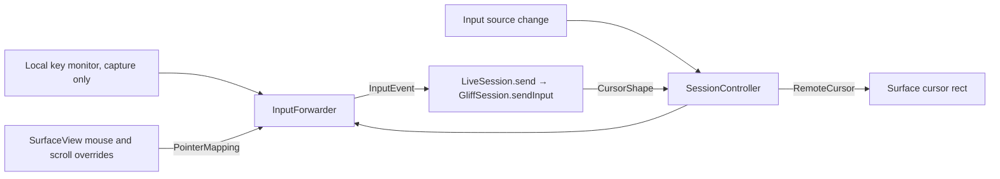

# Task 09 implementation record

Updated: 2026-10-30. Branch `task/remote-input-cursor`, from `main`
`9d33b87`. Status: in review; live Hyprland checks pending (see Limits).
Dependency 07 is merged. Upstream remains the unmodified pinned
`58c742452ded3f10a2ce61f60eb4845f18205e29` (`gliff-server 0.4.1`); the
existing wire surface (`Key`, `PointerMotion`, `PointerButton`, `PointerAxis`,
`Keymap`) expresses everything, so no protocol extension is proposed.

## Delivered behavior

A captured remote surface now controls the remote desktop: physical keys,
pointer motion, buttons, drags and scrolling, with the remote keymap following
the Mac's input source, and the remote cursor shape shown as the local pointer.

| Piece (`macos/GliffMac/Input`) | Role |
| --- | --- |
| `KeyCodes.swift` | Physical macOS key code → evdev table, ISO/ANSI swap, left/right modifier device bits |
| `KeyboardLayout.swift` | Current input source (Text Input Sources), its XKB layout and keymap text, the U.S. fallback |
| `PointerMapping.swift` | Surface points → remote logical coordinates through the renderer's fit; evdev buttons; wheel and trackpad axis events |
| `InputForwarder.swift` | Per-session press bookkeeping: repeat filter, paired releases, `releaseAll`, keymap before keys |
| `RemoteCursor.swift` | Cursor shape validation, the double-cursor policy, `NSCursor` scaled like the picture |

`RemoteSession` gains `send(_:)` and the layout whose keymap went into
`Hello`; `LiveSessionFactory` passes that keymap in `SessionOptions`. The bridge
gains `InputEvent.keymap` (core `InputCommand::Keymap` → `ClientMsg::Keymap`),
queued in order with keys. `SessionController` owns one `InputForwarder` per
session and exposes it only while capturing (`input`), publishes the keyboard
layout and the remote cursor. `RemoteSurface.SurfaceView` routes the events.

### Capture and routing

- Capture starts by clicking the surface (when the preference is on), from
  Connection › Capture Input or the toolbar's keyboard button. The capturing
  click is not sent, so a click meant to focus never lands on the remote.
  Capturing makes the surface first responder and draws the accent border.
- Keys reach the forwarder through `NSEvent.addLocalMonitorForEvents`
  (keyDown, keyUp, flagsChanged), installed only while capturing and removed on
  release, window change and teardown. It takes only events of the surface's
  window while the surface is first responder. A local monitor runs before menu
  key equivalents, so Command chords (⌘Q, ⌘W, ⌘H …) go to the remote as Super
  chords, and it sees the key-ups AppKit does not deliver to views while
  Command is down. No Accessibility or Input Monitoring permission is needed or
  requested.
- Mouse events use the view's own overrides; a tracking area gives motion while
  the window is key. AppKit keeps sending drags and the button-up to the view
  that got the button-down, also outside the window: the position clamps to the
  remote border and the release is sent.
- Release: ⇧⎋ (consumed, never sent; Escape with any other modifier is an
  ordinary key), Connection › Release Input, the toolbar button, resigning first
  responder, the window resigning key or closing, disconnect, reconnect and the
  session's end. Every release lifts all keys and buttons the remote holds.

### Keyboard

- Physical keys: macOS virtual key codes are positions on the ANSI US
  keyboard, so one table serves every layout (letters, digits, punctuation,
  editing, arrows, F1–F20, keypad, JIS Yen/Ro/keypad comma/Eisu/Kana, Menu).
  On ISO keyboards macOS reports the key left of 1 as `kVK_ISO_Section` and the
  key right of left Shift as `kVK_ANSI_Grave`; both are mapped by position
  (`KEY_GRAVE`, `KEY_102ND`), with the hardware family read from Carbon's
  keyboard type, as SDL does.
- Modifiers: Shift, Control, Option → Alt and Command → Super, left and right
  told apart by their device bits in `flagsChanged`. Caps Lock reports each
  toggle once, so each becomes a press and release on the remote. Fn/Globe is
  not sent (macOS already turns Fn+arrows into Home/End/Page keys).
- Repeat: auto-repeat key-downs are dropped; the remote compositor repeats.
- Function and media keys: F-keys are sent when macOS delivers them as F-keys
  (Fn held, or "use F1, F2, etc. as standard function keys"). Brightness,
  volume, media, Mission Control and dictation keys stay with the Mac.

### Layout parity

Keys are physical, so parity needs a remote XKB keymap that matches the
macOS input source. The keymap is XKB text including xkeyboard-config
components by name (`setxkbmap -print` form): the server's `KeyState` and
Hyprland compile it with their own xkeyboard-config.

| macOS input source | Remote XKB symbols | Status |
| --- | --- | --- |
| U.S. (`com.apple.keylayout.US`) | `pc+us(mac)+inet(evdev)` | Supported |
| ABC (`com.apple.keylayout.ABC`) | `pc+us(mac)+inet(evdev)` | Supported |
| French (`com.apple.keylayout.French`) | `pc+fr(mac)+inet(evdev)` | Supported |
| French – PC (`com.apple.keylayout.French-PC`) | `pc+fr+inet(evdev)` | Supported |
| Any other | `pc+us+inet(evdev)` | Fallback: keys type as U.S., shown in orange in the status bar |

`fr(mac)` and `us(mac)` follow the Mac positions (`@#` left of 1 and `<>` right
of left Shift on French ISO) and choose the third level with the right Alt
key. The right Option key is therefore AltGr (`{`, `[`, `|`, `~` …) and the
left Option key stays Alt for Linux shortcuts. Dead keys (`^`, `¨`, `` ` `` …)
are composed by the remote's XKB state.

The keymap of the source selected when connecting goes in `Hello`. A switch is
sent at once (`TISNotifySelectedKeyboardInputSourceChanged`), and the forwarder
also compares the current source before every key press and Caps Lock, so a
key typed with a new layout always follows its `Keymap`. Two sources with the
same XKB keymap are not re-sent. Input methods (Pinyin, Kotoeri …) type with
their keyboard layout: only physical keys are sent, never composed text.
Dictation, the emoji and character viewer, and press-and-hold accents are not
sent; the status bar's keyboard label says so.

### Pointer

Coordinates invert exactly what the renderer draws: view points × backing
scale → the drawable (rounded as the surface sizes its layer) → the position in
`FrameGeometry.fit` → stream pixels → logical pixels (÷ `scale_milli`/1000,
which already folds in any server downscale), clamped to the output. The
geometry is the latest decoded picture's, so mapping always matches the picture
on screen across resizes, Retina moves and configuration changes; before the
first picture nothing is sent. Buttons are evdev codes (`BTN_LEFT`, `BTN_RIGHT`,
`BTN_MIDDLE`, then `BTN_SIDE`, `BTN_EXTRA` … up to `BTN_TASK`), never a bitmask;
each press gets one release.

Scrolling keeps the direction chosen on the Mac (natural or not); the Linux sign
is the inverse of AppKit's. A mouse wheel sends `discrete` ±1 detents of 15
logical pixels, as upstream's client. Trackpads and the Magic Mouse send their
point deltas without `discrete` (finger source), then `stop` on both axes when
the fingers lift. macOS momentum events are dropped: Linux clients scroll
kinetically after `stop` themselves, and forwarding both would double it.
Trackpad pinch, rotate and swipe gestures are not sent.

### Remote cursor

As upstream's client: while capturing, the remote shape is the surface's own
cursor, so the Mac draws it at the real pointer position with no network
latency, and the remote pointer follows through absolute motion. `CursorPos`
is therefore not drawn. Shapes are validated (1–1024 px, full payload, hotspot
inside), drawn premultiplied BGRA, and scaled so a remote pixel covers as many
points as in the picture. A shape without visible pixels (Hyprland shares
transparent or flat images, upstream `hardware-quirks.md`) means "no image":
a headless session hides the local pointer, since its pictures contain the
compositor's cursor; a mirrored session shows the arrow. When not capturing,
the arrow is shown and the remote pointer stays where it was. A malformed shape
keeps the previous one.

## Acceptance evidence

macOS 27.0.1 arm64 (Apple M4 Pro), Xcode 27.1, Rust 1.90.0.

| Criterion | Evidence |
| --- | --- |
| Mapping: edges, scaling, letterboxing | `PointerMappingTests`: corners and centre through letterboxing and pillarboxing, clamping in the letterbox and outside, `scale_milli` 1.6 at backing scales 1 and 2, no point before a picture |
| Buttons, scrolling axes, discrete, stop | `buttonsAreEvdevCodesNotABitmask`, `wheelScrollingSendsDetents`, `trackpadScrollingSendsFingerDeltasThenStop` (momentum dropped) |
| Drag release outside the view | `clicksAndDragsMapToTheLogicalOutput`: a drag past the window clamps to the border and its release is sent |
| Physical keys, ISO/ANSI, modifiers | `KeyCodeTests` (positions, ISO swap, left/right modifiers, keys that stay local, no shared codes); `leftAndRightModifiersFollowTheirDeviceBits`, `capsLockTogglesWithAPressAndRelease` |
| Repeat, stuck keys | `repeatsAndUnpairedReleasesAreDropped`, `releaseAllLiftsEveryKeyAndButtonOnce`; controller: `capturedInputReachesTheSessionAndReleaseLiftsHeldKeys`, `reconnectAndEndForgetHeldInput` |
| Layout switch sends `Keymap` first | `aNewLayoutsKeymapPrecedesItsKeys`, `layoutSwitchesSendTheKeymapFirst`; Rust `the_keymap_goes_in_hello_and_a_changed_one_precedes_later_keys` (wire order) |
| Supported layouts and fallback | `KeyboardLayoutTests`; layout status in the status bar and accessibility value |
| Capture only for the focused surface; release shortcut | `SurfaceInputTests`: the capturing click is not sent, keys of other windows or another first responder are not taken, ⇧⎋ is consumed and releases everything, losing first responder releases |
| Cursor shape, hotspot, double-cursor policy | `RemoteCursorTests`, `theRemoteCursorFollowsShapesAndTheSessionKind` |
| Gates | `remote-input` is now required (macOS): it runs the suites above through `scripts/test-app.sh -only-testing:…` |
| Real Hyprland: edges, scaling, scrolling, drag, US/French text, dead keys, chords, layout change, focus transitions | **Pending** the shared live host (task 08 has priority); see Limits |

## Shortcuts

| Shortcut | While capturing |
| --- | --- |
| ⇧⎋ | Releases capture locally; never sent |
| ⌘-chords handled by the app (⌘Q, ⌘W, ⌘H, ⌘M, ⌘, …) | Sent to the remote as Super chords |
| ⌘Tab, ⌘` (window cycling), ⌘Space / ⌃Space (Spotlight, input sources) | Stay with macOS: system hot keys, never delivered to apps |
| ⌃←/→/↑/↓ (Spaces, Mission Control), F3/F4/Launchpad, ⌘⇧3/4/5 (screenshots) | Stay with macOS |
| ⌘⌥⎋ (Force Quit), ⌃⌘Q (Lock Screen), Fn/Globe shortcuts, media keys | Stay with macOS |

Which hot keys macOS keeps depends on the user's Keyboard Shortcuts settings;
disabling one there lets the key reach the remote. Intercepting them would need
a session event tap and the Accessibility permission; this task does not add
one, so no permission is requested.

## Limits

- **Live Hyprland checks not run yet.** The live host is reserved for task 08
  first. Pending: pointer edges, Retina and `scale_milli` on a scaled output,
  horizontal/vertical wheel and trackpad scrolling, drag release outside the
  window, U.S. and French text, punctuation, dead keys, AltGr, modifier chords,
  a layout switch mid-session, ISO built-in keyboard, focus/fullscreen/capture
  transitions, which shortcuts macOS keeps (table above), and compiling the
  include-form keymaps on the server and in Hyprland.
- ANSI hardware with the French layout, JIS keyboards and external PC
  keyboards are mapped by position but untested. Hardware here: the built-in
  keyboard only.
- Only four macOS input sources have a remote layout; others fall back to U.S.
  visibly. Adding one is a table entry plus a live check.
- Physical keys only: no IME, dictation, emoji viewer or press-and-hold text.
- Hyprland's hotspot is in logical units while its images are physical
  (upstream quirk); the hotspot is used as image pixels, like upstream's client.
- Intel runtime is unverified (no Intel Mac here), as in task 07.
